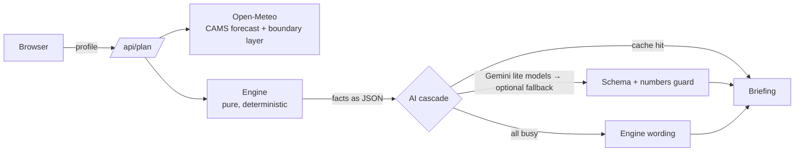

# BreatheWise

**Clear the air.** BreatheWise helps families and communities get through winter smog. It reads the live
smog forecast for your street, plans your family's day around the cleanest hours, fixes the air indoors,
suggests lower-emission alternatives, and shows the measured effect of every choice.

[](https://github.com/Harsha-code-per/BreatheWise/actions/workflows/ci.yml)
[](https://github.com/Harsha-code-per/BreatheWise/actions/workflows/codeql.yml)


**Live app:** https://breathewise-six.vercel.app

**Stack:** React 19, TypeScript (strict), Vite, Vercel Functions, Google Gemini, Open-Meteo (CAMS)

## The problem, mapped to the product

| The challenge asks for…                | BreatheWise does it with…                                                                                                                                                                                                                                                                                                         |
| -------------------------------------- | --------------------------------------------------------------------------------------------------------------------------------------------------------------------------------------------------------------------------------------------------------------------------------------------------------------------------------- |
| Families and communities               | A household profile with a sensitivity flag per member (children, over-65s, pregnancy, asthma or heart conditions, outdoor workers), plus neighbourhood actions you can share with one tap.                                                                                                                                       |
| Severe winter smog and urban pollution | Hourly PM2.5, PM10, NO₂, ozone and US AQI for three days, plus **boundary-layer height**, so it can tell when an inversion is trapping smoke at street level.                                                                                                                                                                     |
| Low-emission daily routines            | Moves workouts, airing the home and the commute into the cleanest hours of the day, and keeps sensitive family members in during the worst three.                                                                                                                                                                                 |
| Indoor air quality hacks               | Sizes a purifier for your room, or a DIY box-fan filter if you have none, using an indoor mass-balance model. Also covers kitchen smoke, incense and mosquito coils, wet cleaning, and the houseplant myth.                                                                                                                       |
| Sustainable alternatives               | Commute swaps with CO₂ saved per week, heating swaps for wood and coal, carpooling, a walking school bus and a no-burning pledge.                                                                                                                                                                                                 |
| Tailored to location and lifestyle     | Describe the family in one sentence and **Gemini fills in the profile**. Location comes from city search, or from the browser (named via OpenStreetMap and rounded to about 1 km), with the network's approximate city as a fallback. The profile covers commute, home size, purifier, cooking fuel, heating and exercise habits. |
| Clearly explaining the direct impact   | Every action carries numbers: % less smoke breathed, cigarettes-equivalent avoided per week, and kg of CO₂ saved. Tap **I'll do this** on any step and the _Your choices_ panel adds up the effect of everything you picked. Gemini explains the reasons in plain language in five languages.                                     |

## How GenAI is used, and kept honest

BreatheWise follows one rule: **the engine owns the numbers, the AI owns the words.**

1. A deterministic engine (`src/domain`) turns the forecast and the family profile into actions with
   quantified impacts. It is pure TypeScript, has no network, clock or randomness, and is 100% tested.
2. **Gemini** (`@google/genai`, structured JSON output) has three jobs:
   - It reads a family's own description into a profile (`/api/intake`).
   - It writes a personalised briefing and a "why this matters" for each action (`/api/plan`).
   - It answers free-form questions in the Ask tab (`/api/ask`).

   The briefing and the answers are grounded in the engine's facts.

3. Every AI reply is validated against a zod schema. A **numbers guard** discards any sentence that contains a
   number the engine did not calculate, so the model cannot invent a statistic.
4. The free Gemini tier is rate limited, so AI calls go through a cascade:
   - a shared cache first;
   - then the fast "lite" models in turn, retrying a busy (5xx) model once and skipping any model that is
     cooling down after a 429, 5xx or timeout;
   - then an optional second free provider;
   - finally the engine's own wording.

   The page always works and always says who wrote it.



## Evaluation map

| Criterion             | Where to look                                                                                                                                                                                                                                                                                                                                                                                                                                                                                                                                                    |
| --------------------- | ---------------------------------------------------------------------------------------------------------------------------------------------------------------------------------------------------------------------------------------------------------------------------------------------------------------------------------------------------------------------------------------------------------------------------------------------------------------------------------------------------------------------------------------------------------------- |
| **Code quality**      | `src/domain/*`: small, pure modules with "why" JSDoc. `api/_lib/handler.ts`: one request pipeline, so each route is about 15 lines. `api/_lib/errors.ts`: a typed error catalogue. Field limits live once in `RANGES` (`src/domain/schemas.ts`) and feed both the schemas and the form. ESLint runs `strictTypeChecked`, `complexity ≤ 8`, `max-lines ≤ 200` and jsx-a11y with zero warnings, and knip finds unused code. `tests/quality/architecture.test.ts` enforces the layer boundaries.                                                                    |
| **Security**          | `vercel.json` sets a strict CSP (no inline script or style, Trusted Types), HSTS, COOP/CORP and Permissions-Policy. The pipeline checks same-origin requests and content type, caps the body at 16 KB, rate limits each IP and validates with zod. The server fetches the air data itself, so clients cannot feed the AI fake facts. Prompt-injection fencing and the numbers guard are in `api/_lib/ai/prompts.ts`. Server logs contain no user data. Location is rounded to about 1 km. Scanning: CodeQL, Dependabot and `npm audit` in CI. See `SECURITY.md`. |
| **Efficiency**        | The landing and app chunks are code-split and lazy-loaded. JS stays under budget (`scripts/bundle-budget.mjs`, about 110 kB gzip in total). The engine runs in the browser, so results show instantly. Upstream calls are cached per 1 km grid cell, identical in-flight requests are coalesced, AI answers are cached, and the AI has a daily budget. The WebGL sky is a single shader with no library, capped at 1.5× DPR, and renders a static frame when reduced motion is on.                                                                               |
| **Testing**           | 310+ Vitest tests at **100% statements, branches, functions and lines**, enforced in `vite.config.ts`. They include property tests (fast-check) and axe-core checks in jsdom. Playwright e2e runs the production build under the real CSP on desktop and mobile, in light and dark themes, with axe WCAG 2.2 AA, and fails on any console or CSP error. See `docs/TESTING.md`.                                                                                                                                                                                   |
| **Accessibility**     | Semantic landmarks and a skip link. ARIA tabs with arrow, Home and End keys. A focusable error summary. Live regions for search, the briefing and chat. AQI is shown as text as well as colour. The hourly chart has a table alternative. Reduced motion and both colour schemes are respected. See `docs/ACCESSIBILITY.md`.                                                                                                                                                                                                                                     |
| **Problem alignment** | The table above, plus `docs/EVALUATION.md`, which traces each requirement to the domain module, UI component and tests.                                                                                                                                                                                                                                                                                                                                                                                                                                          |

## Run it locally

```bash
npm ci
cp .env.example .env.local   # optional: add GEMINI_API_KEY from Google AI Studio (free)
npm run dev                  # http://localhost:5173
```

Without a key everything still works: explanations come from the engine.

## Development checks

| Command         | What it proves                                                                                                              |
| --------------- | --------------------------------------------------------------------------------------------------------------------------- |
| `npm run check` | Prettier, ESLint with 0 warnings, `tsc --noEmit`, knip, tests at 100% coverage, the production build and the bundle budget. |
| `npm run e2e`   | Playwright journeys and axe WCAG 2.2 AA on desktop and mobile, light and dark, under the production CSP.                    |

## Deploy

Import the repository into Vercel (free Hobby plan). Set `GEMINI_API_KEY`, and optionally `GEMINI_MODELS`,
`FALLBACK_AI_URL`, `FALLBACK_AI_KEY`, `FALLBACK_AI_MODEL` and `AI_DAILY_BUDGET`, as described in `.env.example`.
Vercel builds the Vite app and serves `api/*.ts` as functions.

## Where the numbers come from

Every formula and constant cites its source in `src/domain/sources.ts`. The app lists them under "How we calculate":

- AQI bands: US EPA.
- Breathing rates: EPA Exposure Factors Handbook.
- The cigarette equivalence: Berkeley Earth.
- The indoor model and purifier sizing: EPA Guide to Air Cleaners.
- DIY box filter performance: Dal Porto et al. 2022.
- Household fuels: WHO 2014.
- Transport CO₂: UK DESNZ 2024.
- Mosquito coils: Liu et al. 2003.
- Houseplants: Cummings & Waring 2020.

BreatheWise gives general guidance, not medical advice.

## Project layout

```
api/            Vercel functions: air, places, locate, intake, plan, ask
api/_lib/       request pipeline, errors, rate limiting, cache, Open-Meteo and OpenStreetMap clients, AI cascade
src/domain/     the pure engine: AQI, smog detection, time windows, exposure, indoor model, actions
src/landing/    "Clear the air" landing page with the WebGL smog shader
src/dashboard/  the assistant: now panel, briefing, tabs, Ask, sharing
src/setup/      family profile form
tests/          domain, api, ui and quality (hygiene + architecture) tests
e2e/            Playwright journeys with axe
docs/           architecture, accessibility, testing, evaluation and ADRs
```

## License

MIT, see `LICENSE`.
